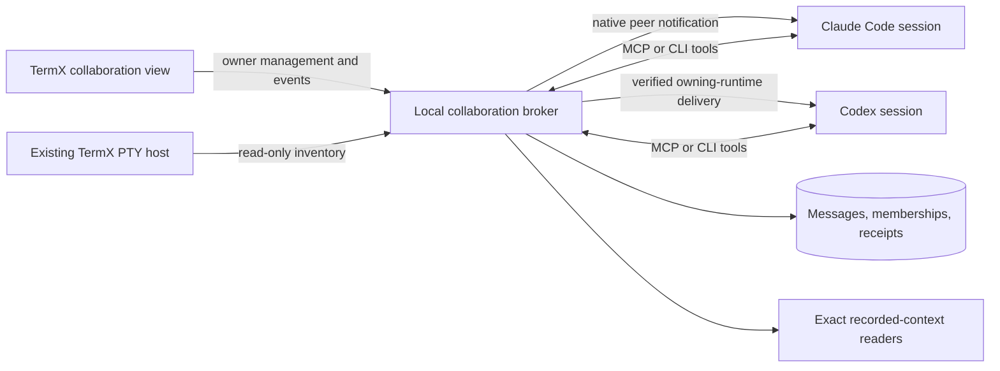

# TermX cross-harness collaboration

Date: 2026-09-08. Status: architecture approved by the user; the first Windows feasibility milestone demonstrated agent-chosen cross-harness context reads, discussion, and idle wake. Production broker/UI implementation and the remaining runtime gates are still open. See [observed results](../reports/2026-09-08-swarm-windows-proof.md).

Baseline: `41a72fc28936fe9a1f4c4b6b4458cb7225225657`. The unchanged application is backed up on GitHub at `backup/pre-swarm-2026-09-08`.

## 1. Product contract

The user connects selected agent sessions, then the agents decide how to collaborate. A Claude Code session running Astra and a Codex session running Astra remain independent sessions, with their existing context, harness behavior, tools, configuration, and model routing. They can inspect each other's recorded conversation, ask questions, volunteer findings, disagree, ask for a review, or continue working independently.

TermX supplies communication and context access. It does not appoint a coordinator, prescribe roles, schedule debate rounds, require replies, impose a message budget, or require approval for each message. There is no automatic end to collaboration just because an agent finishes a turn. Agents can create topics and change their interaction pattern as the work changes.

User activation selects the participating sessions and authorizes mutual context access and messaging. That authorization persists until the user changes it. The user can pause, disconnect, add/remove participants, read the conversation, or contribute a message. The initial implementation concerns sessions on this Windows machine, across any TermX pane, tab, or window; it does not require them to share a folder or model.

An example interaction:

1. Select two tabs, choose **Connect agents**, and select the actual agent panes within those tabs.
2. TermX displays the sessions, their harness/model metadata, and whether their adapters can read context and deliver to the existing live session.
3. Once connected, ask either agent: “Work with the other session on this problem. Look at its context when useful and coordinate as you see fit.” An optional message in the connection panel can provide the same introduction.
4. An agent can inspect its peer's recent work before deciding whether to send anything. It can start an ad hoc topic, reply later, or publish an observation without awaiting permission or a scheduled turn.
5. The collaboration view shows messages, source links, and actual delivery state. Changing tabs or minimizing a pane has no effect on collaboration.

## 2. Findings that determine the design

### TermX

- The terminal host owns PTYs and their lifetime (`host/src/registry.rs:24`); terminal replay is byte history, not a durable message mailbox (`host/src/protocol.rs:1`). Swarm traffic needs its own store and queues.
- Current host authentication grants the whole local UI protocol (`host/src/server.rs:411`), including input and shutdown. Agents must not receive that credential or a generic forwarding interface.
- Exact launch evidence already exists: terminal ID, launcher PID, creation FILETIME, and verified provider ancestry (`host/src/agent_launch.rs:289`, `ui/src-tauri/src/pane_agent_status.rs:40`). The capture index is compacted to current pane records (`ui/src/conversations/captures.ts:131`); it cannot be the peer database.
- Custom shell functions deliberately take precedence over TermX launch wrappers (`host/src/profiles.rs:37`). Existing Astra routing may therefore have no TermX launch stamp. Enrollment must also support a verified existing provider process; missing wrapper metadata must not cause a vanilla relaunch.
- Sidebar multiselection is local presentation state (`ui/src/sidebar/Sidebar.tsx:399`). It can seed a selection dialog; subsequent highlighting must not change an authorized peer set.
- The existing chat normalizer is Claude-specific (`ui/src-tauri/src/chat_feed.rs:118`). Directory-based chat linkage (`ui/src/chat/linkage.ts:45`) is unsuitable for cross-session context authorization.

### Claude Code

Official documentation describes local Windows cross-session messaging and support across providers, including third-party routes, from recent versions. An idle recipient starts a turn; a busy recipient receives between tool calls. Inbound policy can accept, hold, or refuse. Local inspection found installed 2.1.263 and live registry records from several versions, with peer protocol metadata. The isolated proof subsequently verified authenticated named-pipe delivery, peer provenance, idle wake, and draft preservation on 2.1.263 with scoped `accept` policy. Other policies and the user's custom Astra route remain unverified. Do not substitute installed CLI version for the actual receiving process version. [Claude cross-session messaging](https://code.claude.com/docs/en/cross-session-messaging)

The main unresolved Claude issue is enabling unattended receipt for an arbitrary existing session whose inbound policy would hold the message. An existing compatible policy can work; a launch-scoped setting can support future sessions. Do not silently alter user-wide inbound settings, use an own-child credential to disguise a peer, or change ordinary tool permissions.

### Codex

Installed Codex 0.153.4 provides `codex queue --thread ... --message ... --remote ...`. Version-matched generated schemas include queue add/start, live-thread rejoin, `canAcceptDirectInput`, and steering with an expected turn ID. Queue add and queue start are separate operations. Official documentation describes app-server connections, live thread operations, and MCP reload. [Codex App Server](https://learn.chatgpt.com/docs/app-server)

On this Windows machine, daemon lifecycle commands report Unix-only support, `codex agents` requires `--remote`, and the inspected ordinary app-server processes use private stdio connections without an observed public control endpoint. The isolated proof nevertheless showed native `codex queue` waking the original ordinary TUI after its first saved turn; an empty unsaved conversation was rejected. Treat CLI queue delivery and attachable RPC control as distinct capabilities. A new app-server that resumes the same stored conversation is not an acceptable substitute for reaching the original live session.

### Common tool interface

Both harnesses support MCP. MCP can expose the same discovery, context, messaging, and waiting tools, but a passive tool server alone does not establish idle-model wake-up. A command-line helper provides the same operations through an existing shell tool when MCP has not yet been loaded. [Codex MCP](https://learn.chatgpt.com/docs/extend/mcp?surface=cli), [Claude MCP](https://code.claude.com/docs/en/mcp)

## 3. Architecture decision

Use a durable local broker, a common agent tool interface, and capability-tested native delivery adapters. Run the broker as a **companion process** first, independently of the existing PTY host.

Package the companion and helper modes in the portable host executable if practical: `termx-host.exe --swarm-broker`, `--swarm-mcp`, and `swarm <operation>`. These are separate processes/modes, not another PTY host. A newly installed executable can run these modes while the previous terminal-host process stays alive.

Enrollment supplies the trusted absolute path to the newly shipped helper. An existing session's `TERMX_HOST_EXE` may still name an older executable without swarm modes; do not depend on changing that environment. Use the established Windows staging/backup strategy or a versioned executable path, verified while the old process remains running.

The broker owns a separate discovery record, process identity, named-pipe endpoint, and `swarm_v1.sqlite` store under the TermX data directory. Use one broker authority per data directory, with an OS-enforced single-instance claim and verified server identity. No second broker may concurrently claim the same live authority. The trusted inventory client exposes only the specific read operations it needs; agent RPC has no path to raw terminal input, layout mutation, process close, or host shutdown.

A broker crash, parser error, slow peer, or failed database migration must leave ordinary terminals operational. UI closure does not stop collaboration while enrolled sessions remain alive. When no UI or live participant remains, the broker can flush and exit; durable history survives. Future integration into the main host is optional and requires a single-owner store handoff, not a redesign of peer semantics.

Owner management has a separate authentication path. Trusted native UI/bootstrap creates or reads a random private broker-owner credential stored with an explicit current-user/logon ACL; the broker validates it in an owner handshake after the client verifies the server process and boot identity. The credential stays in native code and is never returned to the renderer, MCP/CLI peer tools, or diagnostic output. Possessing a pipe name, sharing the OS account, claiming a UI PID, or submitting `role: owner` does not create owner authority. A peer helper can only establish a peer principal. Keep the main host's inventory credential internal to its narrow client as well.

Alternatives considered:

| Approach | Strength | Reason not to choose it as the complete feature |
| --- | --- | --- |
| MCP mailbox alone | Portable agent-chosen read/send operations | Does not prove automatic delivery to an idle existing session. Keep it as the common interface. |
| Broker plus native adapters | Preserves independent harness sessions and enables exact delivery where supported | Recommended; per-version capability tests and some setup are necessary. |
| TermX owns every agent through SDK/app-server from launch | Strong structured control | May require migrating existing sessions and changes launch ownership. Keep as an explicit fallback where direct attachment is unavailable. |

Agent Mail demonstrates useful inbox/thread/acknowledgement primitives; AgentAPI demonstrates terminal-driven adapters. Neither supplies TermX's exact pane identity and lifecycle integration automatically. Do not adopt an external orchestration framework or introduce a universal terminal-typing loop as the foundation. [Agent Mail](https://github.com/Dicklesworthstone/mcp_agent_mail), [AgentAPI](https://github.com/coder/agentapi)

## 4. Identities, membership, and continuity

Keep these distinct:

| Identity | Meaning |
| --- | --- |
| Authority and boot epoch | This TermX data-store authority and its current process generation |
| Terminal ID | Existing shell/PTY resource, namespaced by authority |
| Harness conversation/thread ID | Recorded conversation; potentially shared by more than one live writer |
| Launch ID | One verified live harness invocation, with exact PID/creation-time evidence |
| Peer ID | Durable collaboration participant, explicitly bound to a launch and binding revision |
| Group and membership revision | User-authorized participant set, independent of layout and working directory |
| Topic/thread ID | Optional conversation organization chosen by agents or user; not an execution workflow |

A public peer ID is an address, not an authentication secret. The broker stamps sender identity and author role from the authenticated connection. Agents cannot assert they are another peer or the user. Model and harness are separate metadata: `claude-code` can run an opaque/custom model name; unknown model metadata does not disable communication.

Rename, reorder, split, minimize, maximize, and window movement retain membership. A model change updates metadata. A transient disconnect retains the peer but reports its connection state accurately. Process exit marks the exact launch offline. A new conversation in the same pane does not inherit the old mailbox or context grants. A verified same-conversation resume can rebind through an explicit continuation transaction, recording predecessor/successor and rotating the binding generation. Ambiguous continuity stays unbound.

Only an authenticated owner can commit **Continue collaboration** for a newly verified launch. It requires the expected old binding/membership revision, explicit user continuation intent, and verified conversation/branch continuity; matching conversation IDs alone is insufficient. Two competing successors cannot both acquire the binding. The action carries forward the peer's group membership and pending broker mailbox for that continuation, while preserving original recipient binding and recording the new delivery binding. Already acknowledged messages are not requeued. Previously accepted native deliveries with uncertain receipt stay marked uncertain until reconciled, rather than being blindly resent to the successor.

The continuation re-establishes the authorized conversation source against the new launch. Existing snapshot cursors remain pinned to their historical source/generation; new context reads use the new binding revision. An unrelated/forked or unverifiable source requires fresh enrollment and grants. Without the explicit continuation transaction, all predecessor mail stays addressed to the predecessor and cannot reach a new process occupying its pane.

Initial group management belongs to the user. Within the connected set, agents can choose recipients, start topics, and send or inspect context without another approval. Changes to highlighted tabs do not enroll additional agents. The first version addresses the main harness sessions represented by panes; delegated tool use acts under that session's identity unless the harness provides verifiable finer-grained attribution.

### Existing-session enrollment

The broker verifies the selected provider runtime against the terminal shell and native session registry/capture evidence. A TermX wrapper stamp is useful but not required if the actual provider process and conversation can be proved independently.

For CLI/MCP calls on Windows, use a local named pipe with an explicit user/logon-scoped ACL, remote-client rejection, and verified server identity. Obtain the connecting PID from the OS, retain process handles, validate creation times and ancestry to exactly one enrolled harness runtime, and refresh the process snapshot before binding. A model-supplied PID, environment value, or peer ID is insufficient. CLI calls and persistent MCP bridges use the same authorization path. [Windows named-pipe client identity](https://learn.microsoft.com/en-us/windows/win32/api/winbase/nf-winbase-getnamedpipeclientprocessid)

A shared/detached app-server may not preserve a unique OS ancestry path to one thread. In that case require a runtime-authenticated per-thread bridge or explicit verified enrollment credential; never guess from the shared server PID. This is an early feasibility test for Codex. Local same-account process capabilities do not constitute an OS sandbox against other programs running as that account.

## 5. Agent-facing capabilities

Expose a small vocabulary through MCP and equivalent structured CLI commands:

| Operation | Purpose |
| --- | --- |
| `whoami` | Resolve the caller's authenticated peer, live binding, groups, and capabilities |
| `list_peers` | Find authorized peers, harness/model metadata, context availability, and connection state |
| `read_peer_context` | Read a source-bound snapshot or page of an authorized peer's recorded conversation |
| `send_message` | Send to one or several authorized peers, optionally with topic, reply, or source references |
| `read_messages` | Inspect inbox or an authorized thread from a stable cursor; ordinary reads do not imply a reply |
| `wait_for_events` | Wait for relevant messages or requested peer state/context changes without busy polling |
| `acknowledge_message` | Record explicit receipt; independent from agreeing or replying |
| `publish_status` | Publish the caller's own optional short status or work references |

The tool descriptions explain provenance and available operations. They do not impose a planner/reviewer split, response template, conversational quota, or requirement to keep talking. No hidden coordinator model is necessary. The group remains connected when agents independently conclude their current work.

Peer content remains attributed peer material. It never grants human approval, answers another session's permission dialog, changes model/permissions, or expands the peer's authorization scope. Existing independent harness tools and OS permissions remain outside TermX's collaboration policy.

## 6. Context is a first-class capability

Agents must be able to peek at useful context before choosing an interaction. The broker resolves a peer's exact authorized context source server-side; agent tools accept peer/source IDs, not arbitrary filesystem paths or “latest session in this folder.”

Return recorded user and assistant messages, tool activity/results where available, compaction summaries, and source references. Start with recent context and allow paging/search/detail reads. Do not present a shortened UI view as complete history. Do not export internal reasoning or raw authentication/environment/configuration data as peer context.

Each response includes peer and launch identity, harness conversation ID, source generation, snapshot high-watermark, captured-through position/time, available kinds, and completeness/lag/ambiguity. Source references let a message cite the observation on which it rests. Opening another session's context does not acknowledge that agent's message inbox.

Source IDs, snapshot cursors, and forwarded references are not bearer grants. Every page, search, detail read, and reference dereference checks the caller's current group membership/policy revision, source grant, owner binding, and permitted generation. Membership in overlapping groups does not union their grants. Revoked/paused source access invalidates further reads through old cursors. The enrollment grant describes the selected recorded history being shared; it does not claim that the model can forget material already obtained.

Cursors bind to file/native-source identity and revision, not just byte offset. Handle append, partial UTF-8/JSON, compaction, truncate/regrow, replacement, missing source, access loss, and fork/branch lineage. Paging a snapshot must not silently switch to a different conversation or source generation halfway through. No peer-pair process scans or full-history reloads on every poll.

Extract reusable pure transcript parsing into a small shared Rust context library with thin Tauri wrappers. Add a Codex reader that supports its actual exported/paginated formats; the current rollout index is not a complete context service. Native app-server reads are preferred where they can prove the selected live thread without loading a second runtime.

When multiple launches share one transcript, disclose shared-conversation provenance and retain the ambiguity. Do not label mixed-writer history as the exclusive work of one agent. If the source includes contributions outside the permitted shared set and cannot be separated, require a separately authorized shared source or report it unavailable.

## 7. Durable messaging and truthful status

Use SQLite with one serialized writer, WAL, an explicit FULL synchronous durability policy, versioned migrations, and bounded worker queues. The durable entities are peers/bindings, groups/memberships, messages/topics, recipient deliveries, receipts, and context-source references. Do not copy all provider history into this database merely to read it.

`send_message` carries a client idempotency key. One transaction checks current membership, freezes the recipient set, assigns a broker sequence, and commits message plus delivery rows. Retrying the same key and payload returns the same committed result; a conflicting payload is an error. Sender clocks do not define ordering. Each recipient progresses independently, so one offline session does not stall the others.

The ordering domain is one monotonic sequence per collaboration group. Each recipient's normal mailbox/replay is the ascending projection of that sequence onto its committed recipient rows; sequence gaps belonging only to other recipients are not missing messages. A topic uses the same group ordering. Reads may inspect specific older messages independently, but acknowledgements remain per-message, and a contiguous acknowledgement watermark never skips an unacknowledged eligible row. Disconnection and broker restart preserve order and gaps. If an adapter delivers full bodies natively, serialize that recipient's submissions; an earlier held/uncertain item remains explicit rather than silently being overtaken or marked read by a later receipt. Coalesced wake notices point to the canonical ordered mailbox. These rules preserve chronology without scheduling agent responses.

| Visible state | Evidence required |
| --- | --- |
| Sending / outcome unknown | Request in flight or acknowledgement lost before reconciliation |
| Saved / pending | Broker durably committed the message for the exact recipient binding |
| Native queued | The harness or adapter positively accepted a native queue item, when observable |
| Fetched / acknowledged | Recipient bridge/agent explicitly reports the specific message IDs it received |
| Replied | A later message explicitly references this message |
| Held / unavailable / disconnected | Actual policy, capability, or connection evidence, with reason |

No state claims comprehension. Socket write success, a terminal echo, a live PID, or the user opening the collaboration view cannot mark a message read by an agent. Transport retries use stable IDs and reconciliation. Do not promise end-to-end exactly-once effects across a crash after a harness saw content but before it recorded receipt.

Prefer small, coalesced **inbox changed** wake notifications that cause the agent to fetch authoritative messages. Message content stays individually durable and is never discarded by notification coalescing. This reduces duplicate prompt text and works with harness inbox pressure. If the selected integration cannot fetch yet, use a clearly attributed message envelope and retain its weaker receipt semantics.

The observed Codex CLI queue records input with user role. On that path, send only a fixed broker-authored wake notice and fetch peer content through the scoped mailbox tool; peer-controlled message bodies, display names, and topics must not be interpolated into the wake notice. A visible peer label in an ordinary user message is not a native provenance boundary. The full-body fallback above cannot be advertised as equivalent on this path until its source-trust and approval behavior is proved.

## 8. Delivery and adapter contract

Every adapter reports independently whether it supports exact binding, context reading, tool access, active-turn delivery, idle wake-up, queue reconciliation, and receipt observation. A generic “connected” flag is insufficient.

- **Claude:** use its native peer inbox for the exact selected live session. Verify endpoint, process identity, target session ID, protocol version, and proper peer credential. Respect inbound accept/hold/refuse. Do not steal the own-child exemption or manufacture human provenance. Capability and session-scoped setup are part of enrollment.
- **Codex:** target only the verified original live conversation. For ordinary TUIs, the native CLI queue is a separately characterized receive path and does not imply an attachable RPC endpoint. For RPC adapters, connect only to the actual owning runtime, verify loaded thread and direct-input capability, and rejoin only that already-loaded thread when needed for subscriptions. Prefer supported queue semantics; steering requires the expected active turn. Omit model, effort, cwd, permission, and collaboration-mode overrides. Prove each offered path's idle queue draining and approval ownership before shipping automatic delivery.
- **Other harnesses:** use the same tools and context adapter contract. Advertise cooperative-only or unavailable capabilities truthfully until a receive/wake integration is implemented and tested.

For Windows Codex, prefer the observed native CLI queue path where the ordinary TUI and saved conversation can be verified. If RPC control is required, test an opt-in locally owned app-server plus native `codex --remote` launch that preserves the user's setup as a separate capability. Explain the required handoff; never start a second writer to the same conversation or silently replace a running agent. A cooperative mailbox is useful but does not satisfy the full autonomous-wake acceptance criterion by itself.

Pause commits a new policy revision, stops new routing and peer operations, and preserves history/backlog. It does not kill agents or cancel their unrelated work. Already delivered content cannot be recalled; cancel only proven broker-owned native queue entries when the adapter supports it. Removal/rebinding invalidates old connection generations and prevents pending mail from landing in an unrelated replacement or any successor without the explicit continuation transaction in section 4.

## 9. Stability without conversational limits

There are no round, message-count, token-budget, or mandatory-summary cutoffs imposed by TermX. Agents retain discretion about how much communication is useful.

Finite transport frames, paged reads, bounded active buffers, request timeouts, notification coalescing, and retry backoff keep the program stable. Accepted content is durable on disk; temporary upstream inbox limits become pending/backpressure state. They do not silently delete messages or terminate a discussion. Avoid model polling loops when a native event or blocked tool wait can serve the same purpose.

Disk-full/commit failure must never report a message saved. A slow context read cannot block the database writer or PTY processing. Parser failure is isolated to the source. Unsupported schema versions are preserved and rejected without destructive downgrade. Archive/retention is visible user management, separate from agent conversation policy. Broker shutdown flushes its own work and never invokes terminal shutdown.

## 10. TermX interface

Add **Connect agents** to selected-tab and pane actions, plus a collaboration view reachable from the menu/rail. A multi-pane tab expands into individual eligible sessions before connecting. User-visible copy explains that participants can read each other's recorded conversation and send messages. Selection shows actual harness, model when known, folder, and readiness without treating labels as identity.

The collaboration view contains:

- Participants with links to their panes, connection/capability state, and context source freshness.
- Messages and agent-created topics with per-recipient status and source links.
- A user composer that can address selected peers as the authenticated user.
- Connect/disconnect, add/remove, and pause/resume controls.

Use a separate `SwarmClient`/store/controller; `WorkspaceController` supplies layout labels and enrollment intents but does not become the broker. Multiple windows consume the same committed event stream. UI visibility and pane attention remain distinct from agent message receipts.

## 11. Staged delivery plan

### Stage 0 — prove both directions on Windows

Build disposable capability probes in isolated data directories; do not message or restart the user's current work. Use exact installed/live-compatible harness versions and synthetic prompts/workspaces. Validate the user's routing shape without printing or copying credentials.

Prove: exact existing-session identity; Claude peer-policy behavior; Codex existing-TUI owner discovery; idle wake; busy delivery without interrupting a running tool; preserved composer draft; single runtime; unchanged model/route/settings; MCP reload or CLI fallback; and actual receipt from the receiving agent. Include the reverse path and a context read before a reply. Test both matching and mismatched native inbound permission classes.

Include two independently enrolled Codex threads sharing an app-server: each must obtain its own correct tool principal, reject sender substitution, and support revocation independently. A shared server PID or MCP process environment cannot stand in for thread authentication. Also run a minimal real-agent interaction with only a broad collaboration introduction: the agents choose a useful context read and message themselves, and a later chosen peer message wakes an idle member without another human submission. This is an acceptance scenario, not a prescribed user workflow.

Output a capability matrix with observed results and a specific supported activation path. If default Codex Windows attachment fails, test the explicit remote-runtime fallback. Resolve this before committing the product to a one-click arbitrary-existing-session promise. No polished UI or broad broker rollout precedes this proof.

Report ordinary-existing-TUI attachment and verified remote-runtime launches as separate capability rows. Fallback success cannot count as proof that arbitrary already-running TUIs are reachable. Compare effective provider route, custom model, effort, permissions, cwd, and configuration sources across any handoff, not only the model's display label.

### Stage 1 — companion, identity, and durable core

Implement focused modules under `host/src/swarm/`: types/principals, process binding, named-pipe transport, correlated RPC, lifecycle/discovery, SQLite store, and broker. Add dispatch modes in `host/src/main.rs` without changing normal host startup semantics. Add narrow internal inventory reads and a CLI helper.

Prove authorization, crash-safe send/idempotency, per-recipient replay, binding generations, revocation races, single-instance behavior, and broker-failure isolation with deterministic fakes and temporary stores. Existing PTY protocol stays unchanged. A feature-disabled installation must behave as before.

### Stage 2 — context and agent tools

Implement the shared context library, Claude/Codex sources, snapshot paging, provenance, and MCP bridge over the same scoped RPC used by the CLI. Add self/discovery/read/send/wait/ack/status operations. Preserve current Tauri transcript behavior through thin wrappers and existing regression tests.

Identity/storage and context work can proceed independently once their contracts are fixed. Native adapter experimentation from Stage 0 informs the common capabilities rather than leaking provider-specific fields into every broker operation.

### Stage 3 — first complete pair with user controls

Implement the proven Claude and Codex delivery paths and the minimal collaboration view together. Suggested new UI modules: `ui/src/swarm/{types,client,store,controller,SwarmPanel}` with native broker management in `ui/src-tauri/src/swarm.rs`. Wire through `App.tsx`, sidebar actions, and menu models. Keep attention/minimize/selection semantics intact.

This first usable slice must let each member inspect the other, independently choose to send, receive while busy or idle through the advertised path, and continue without fixed rounds or per-message approval. The user must be able to observe and pause it. A mailbox-only demo is not completion of the feature.

### Stage 4 — failure testing and controlled rollout

Run concurrent-message, reconnect, dropped-ack, process-reuse, compaction, slow-reader, large-backlog, disk-failure, and broker-crash tests. Cover multiple tabs/windows, minimized panes, native policy holds, user typing/approval, and model changes. Verify old-host/new-UI compatibility and that current terminals stay running during companion deployment.

Build via the existing Tauri release path, stage portable executables with dated backups and hashes, document setup/migration limits, and exercise an explicitly selected test collaboration. Keep the prior executable pair and pre-swarm GitHub branch as rollback points. Disabling/removing the companion leaves swarm history intact and ordinary terminals usable; do not downgrade a newer store schema in place.

### Later extensions

Add adapters, optional shared artifacts/status conventions, remote participants, or richer UI only after the first pair is reliable. File leases, forced worktrees, task assignment, provider-native teams, an orchestration model, and a marketplace are separate product decisions. The interface should permit agents to develop those conventions themselves through messages without requiring them.

## 12. Acceptance matrix

| Area | Required evidence |
| --- | --- |
| User intent | Agents choose when to read/send/reply; no round/message quotas or repeated message approvals; differing harnesses/models remain intact |
| Identity | Same names/cwd/model/conversation, nested processes, PID reuse, no wrapper stamp, fork/clear/resume, and stale registry cannot misroute content |
| Delivery | Idle/busy/tool-running/approval/draft states; no second runtime; native accepted versus fetched accurately separated; ordered per-recipient replay, held items and acknowledgement gaps; uncertain retries deduplicated where provable |
| Context | Exact authorized source, paged large histories, partial records, compaction/rotation/truncate-regrow, shared-writer ambiguity, stale generation, unsupported source, overlapping groups and forwarded/revoked cursors |
| Durability | Concurrent sends, lost acknowledgements, duplicate keys, crashes around commit/receipt, offline peers, store busy/full/corrupt, restart replay with existing live peers |
| Authorization | Peer cannot forge sender/user/owner, mint owner credentials, enlarge membership, read unrelated sources, acknowledge another recipient, or access terminal administration; two threads in one runtime remain distinct |
| Lifecycle | Pause/remove racing with reads/sends; explicit continuation transfers only authorized backlog/grants; competing successors and stale receipts rejected; broker restart preserves live peers; changed host identity cannot recycle membership |
| Isolation | Broker failure, invalid source, or slow peer leaves terminal input/output and other recipients working; active memory does not grow with retained history |
| Integration | Existing regression suites, real agent-chosen Windows collaboration and idle wake, UI accessibility/multiple windows/hidden panes, trusted new helper path from old custom-route sessions, portable backups, clean old-host compatibility |

Estimated implementation scope after Stage 0: roughly 35–55 production/build files plus focused tests, concentrated in a new broker module tree, context library, and UI feature directory. The difficult work is live-runtime integration and identity/delivery correctness; the panel is a smaller part. Stage 0 can materially change the adapter/setup portion of that estimate.

## 13. Decisions and remaining proof obligations

The first runtime experiments changed one activation assumption: on installed Windows Codex 0.153.4, `codex queue` can deliver to the ordinary existing TUI after a conversation has saved history, without launching a remote TUI. An empty unsaved conversation was rejected. Prefer this verified native CLI receive path where applicable; do not infer an externally attachable owner RPC endpoint from it. Scoped MCP tools demonstrated the common read/send surface after a deliberate setup handoff, while shared-runtime dynamic tools demonstrated per-thread caller identity. These paths need production adapter contracts and the remaining failure/policy tests in the [proof report](../reports/2026-09-08-swarm-windows-proof.md).

Settled by the user's request: autonomous discretionary collaboration after activation; peer context inspection; arbitrary useful message volume; no fixed workflow; preservation of harness/model choices; staged development with strong stability work.

Recommended architecture: companion broker, exact peer bindings, durable messages, source-bound context reads, common MCP/CLI tools, native receive adapters, and visible user controls.

Runtime proofs still required include tool activation in arbitrary already-running sessions, full launch/configuration parity (including Claude/Astra), the remaining inbound and approval policy matrix, and failure/retry/rebinding behavior. Ordinary Codex wake-up and shared-runtime per-thread dynamic-tool routing have observed evidence; headless runtime tests do not establish remote-TUI composer or approval ownership behavior. The report separates these tested capabilities from the remaining gates.

Research artifacts: `.superpowers/swarm-research/{core,claude,codex}.md`, local CLI evidence, and version-matched Codex protocol schemas. No current session was messaged, restarted, or reconfigured during research.

Independent core and Codex design reviews were completed. Owner authentication, continuation/backlog transfer, source-grant revalidation, ordered replay, and the agent-chosen Stage 0 interaction were tightened in response. The corrected architecture has no outstanding review blocker; the runtime proofs above remain required before implementation claims.
